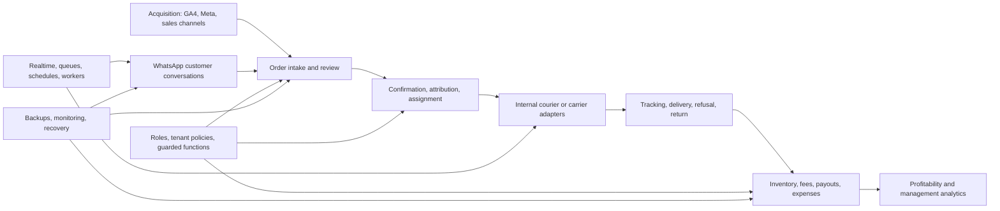

# iGrowFast Technology and Operations Dossier

> **Confidential — investor diligence material**
>
> Evidence date: **2026-08-24** · Audited repository head: `790f84e315614ccb065969b9004ce6dffbc8ad21`
>
> Live evidence was captured in two read-only passes, 2026-08-23 and 2026-08-24. The second pass closed every system area the first could not reach.

## Executive statement

iGrowFast is not a prototype dashboard and not a thin wrapper around third-party tools. It is an integrated commerce operations platform that connects acquisition, customer conversations, order execution, logistics, staff governance, operational finance, analytics, and infrastructure control in one system.

The principal technology asset is the workflow and control layer accumulated across those domains. Orders, customer conversations, provider events, collaborator permissions, inventory consequences, payment classifications, and management reporting share one tenant-aware operating model. This reduces the fragmentation that normally forces commerce businesses to reconcile multiple dashboards, spreadsheets, messaging accounts, and carrier portals by hand.

The platform owns meaningful backend and operations depth: a self-hosted PostgreSQL/Supabase estate, hundreds of schema migrations, guarded database operations, private realtime broadcasts, a dedicated communications worker, carrier and marketing integrations, email infrastructure, backup and recovery tooling, and an explicit security-remediation history.

This dossier presents that work strongly but does not invent traction or assurance. It makes no claim about revenue, customer count, market share, uptime SLA, regulatory certification, or independent penetration-test status because those facts were outside the evidence set.

## Investment thesis

### 1. The hard asset is operational integration

Individual order pages, analytics charts, or messaging screens are reproducible. The harder asset is preserving consistent business rules across the entire operating cycle:

- acquisition data becomes attributed orders;
- customer conversations remain connected to order history;
- role permissions remain connected to tenant and resource scope;
- parcel and provider events remain connected to internal status semantics;
- delivery outcomes remain connected to inventory, fees, payouts, and profitability;
- every subsystem remains connected to backup, monitoring, and recovery procedures.

This connected layer is expensive to reproduce because it contains accumulated domain decisions, exception handling, historical corrections, and operational controls rather than only UI components.

### 2. The product supports organizational scale, not only transaction entry

The system defines separate operating environments for platform owners, business owners, super administrators, administrators, commercial agents, couriers, media buyers, and communications teams. Authority is expressed through routes, page entitlements, integration scopes, tenant policies, column privileges, guarded functions, and account-lifecycle controls.

That matters commercially: a business can delegate work without giving every collaborator unrestricted access to money, customers, external accounts, or other tenants.

### 3. The engineering program has moved beyond feature accumulation

The project history shows systematic hardening:

- broad browser-side queries were replaced by server-side pagination and aggregates;
- broad database-change subscriptions were replaced by targeted private broadcasts;
- provider statuses gained deterministic reconciliation and exception queues;
- user deletion became checked archive/delete lifecycle management;
- privileged operations gained tenant and caller guards;
- storage cleanup became reference-aware report/quarantine/purge;
- backup work expanded into layered recovery, watchdogs, archive monitoring, and restore tooling.

The value is not the number of commits. It is the repeated conversion of fragile operations into controlled, observable workflows.

## Platform at a glance

| Dimension | Evidence-backed inventory |
| --- | ---: |
| Distinct roles in the database authority model | 7 |
| Declared application route elements | 106 |
| Application source files | 456 |
| Page files | 94 |
| Components | 191 |
| SQL migrations | 341 |
| Non-shared edge-function directories | 38 |
| Operations tracked files | 279, including 4 tracked dotfiles |
| Public + WhatsApp application tables | 102 |
| Public + WhatsApp database functions | 411 |
| Public + WhatsApp triggers | 119 |
| Database indexes in `public` | 361 |
| Carrier adapters implemented | 5 |
| Application source lines | 193,198 |
| SQL migration lines | 30,892 |
| Named database schedules, all unattended | 30 |
| Row-level security policies | 280 |
| Anonymous-role privileges on application tables | 0 |
| Core self-hosted containers observed healthy/running | 13 |
| Servers operated, all firewalled and privately networked | 3 |
| Edge tunnels serving the platform, each healthy at four connections | 3 |
| Identity-protected administrative surfaces | 3 |
| Scheduled backup lanes within their declared freshness budgets | 21 of 21 |
| Off-site recovery objects in dedicated backup stores | 34,590 |
| Continuous WAL archive failures | 0 of 1,862 |

These numbers demonstrate implementation and operating breadth. They do not measure adoption, quality by themselves, or commercial performance.

**For the exhaustive inventory** — every role, route, screen, module, edge service, scheduled job, and database table named individually rather than summarized — see [chapter 18, Complete application surface inventory](investor-dossier/18-complete-application-surface-inventory.md) and [chapter 19, Backend service and data catalog](investor-dossier/19-backend-service-and-data-catalog.md). Those two chapters exist because summary narrative consistently understates the delivered surface.

## Product and business capability map

| Domain | What exists | Business value |
| --- | --- | --- |
| Platform governance | Businesses, plans, platform billing, users, service status, geography, configuration, templates, and backup visibility | Central control across the platform estate |
| Tenant administration | Collaborators, permissions, products, customers, integrations, finance, analytics, documents, and business billing | One operating environment per business |
| Order operations | Manual entry, imports, sheet review, search, filters, duplicate signals, history, bulk actions, trash/recovery | Reduces manual reconciliation and state loss |
| Logistics | Internal couriers, carrier adapters, parcels, batch creation, labels, tracking, delivery notes, return notes | Connects provider execution to internal truth |
| Commercial operations | Seller workspaces, attribution, notes, postponement, wallet, payouts, demands, and statistics | Turns sales execution into measurable operations |
| Acquisition | Media-buyer campaigns, product advertising, attributed orders, GA4, Meta Ads, payouts, and statistics | Links spend and campaign activity to fulfillment outcomes |
| Customer communications | Multi-number WhatsApp inbox, assignments, contacts, tags, quick replies, schedules, media, presence, and order context | Keeps conversations inside the operating record |
| Finance | Transactions, expenses, recurring charges, business payments, collaborator ledgers, profitability, salaries, and statements | Provides operational financial control and accountability |
| Analytics | Orders, profitability, shipping, inventory, channels, customers, sellers, couriers, media buyers, users, and business health | Management visibility without full-table browser calculations |
| Commercial documents | Delivery and return notes, labels, export, PDF/DOCX/XLSX generation, QR/barcodes, business documents | Converts workflows into usable operating artifacts |

## End-to-end operating flow

## Users, roles, and governance

The user model is layered rather than menu-only:

1. Authentication establishes the account session.
2. Account-state checks reject inactive or archived identities.
3. Role-specific route trees separate platform governance, tenant management, sales, delivery, acquisition, and communications.
4. Page-level permissions restrict administrative workspaces and direct URL access.
5. Invitation-time scopes restrict WhatsApp numbers, analytics properties, and advertising accounts.
6. Tenant-bound RLS, grants, triggers, and functions enforce the data boundary.
7. Business-owner continuity controls guard operations that could remove the last active owner.

The live database inventory found 280 policies and no RLS-disabled tables in the public, WhatsApp, or storage application schemas. The audit did not run a new live test identity through every route and function, so the dossier does not claim exhaustive authorization certification.

## Orders, logistics, and provider execution

Orders are the platform's operational spine. They can enter through direct entry, imports, sales-channel review, or customer-conversation context. The workflow preserves confirmation, assignment, status history, postponement, attribution, provider linkage, delivery/return documents, payment classification, inventory effects, and analytics consequences.

Carrier integration source covers tracking, individual and batch parcel creation, labels, delivery notes, city/network/store discovery, parcel changes, and webhooks. Adapter branches exist for Ozon, Coliaty, Ameex, Quick Livraison, Vitex, Sendit, and Delvo.

Provider events are not blindly accepted as truth. Internal mappings, flow ranks, terminal-state protection, deduplication, and an unmatched-status queue preserve exceptions for review instead of silently discarding or regressing operational state.

## Finance, analytics, and commercial control

iGrowFast implements operational finance rather than claiming to be a certified accounting ledger. The product connects delivery/payment outcomes to collaborator transactions, courier settlements, expenses, recurring charges, business payments, inventory value, profitability, and role-specific statements.

The analytics workspace covers profitability, business health, orders, advertising, shipping, inventory, sales channels, customers, sellers, couriers, media buyers, and users. Scale work moved material calculations into database-side aggregates and bounded APIs, removing dependence on loading entire operational tables into the browser.

Financial integrity work includes tenant-scoped operations, overpayment guards, canonical amount definitions, guarded bulk actions, preserved historical snapshots, and role-specific payout paths. The audit intentionally did not inspect or independently reconcile customer financial rows.

## Customer communications and WhatsApp operations

The WhatsApp system is a separate operating subsystem, not a single send-message button. It includes:

- multi-number inboxes and assignment-aware access;
- contacts, profiles, tags, quick replies, scheduled messages, media, search, and presence;
- customer order context and conversation-linked order workflows;
- durable outbound queues with claim, retry, dead-letter, and cancellation semantics;
- inbound webhooks and media ingestion to R2-backed storage;
- node-scoped leases, heartbeat reporting, and self-healing behavior;
- private database-backed broadcasts and bounded reconciliation after reconnects.

The Realtime service, queue tables, empty legacy publication, and targeted broadcast publication were live-verified. The separate worker node appeared online through the private overlay, but worker, provider-session, and cache runtime health could not be directly inspected; those claims remain unverified.

## Integrations

The repository contains concrete server-side integration code for:

- delivery carriers and parcel providers;
- Google Analytics 4 reporting;
- Meta Marketing account, insight, campaign, ad-set, ad, budget, pixel, and audience operations;
- Google Sheets ingestion and review;
- Evolution API and WhatsApp webhooks/actions;
- Cloudflare R2 media and backup-oriented workflows;
- SMTP/Stalwart email delivery and event handling;
- Web Push/VAPID notifications;
- provider polling, tracking synchronization, and webhooks.

Credentials are designed to remain on the server side. This audit excluded secret values and did not test the current validity or permissions of every external account.

## Application architecture

### Frontend

The main application is a React 18 and TypeScript SPA built with Vite, React Router, TanStack Query, Radix/Tailwind, Zod/forms, Recharts, mapping, document-generation libraries, QR/barcode support, and motion/3D tooling. A separate Astro project provides the marketing and legal surface.

The frontend is organized around role workspaces, shared domain components, server-side list/query contracts, permission-aware navigation, and tenant-aware cache boundaries. Two repository workflows build and release the application and marketing site.

Isolated verification on 2026-08-23 passed `npx tsc -b`, the root production build, Astro check, and Astro build. The same verification found that `npm run lint` fails with 1,562 errors and 100 warnings, including a Rules of Hooks violation at `src/whatsapp/routes/admin/conversations/parts.tsx:5944-5952`; `npm test` exits 1 because no test files are present. The current release workflows do not run lint. These are unresolved quality-gate risks, not remediated findings.

### Backend and edge

The backend uses a self-hosted Supabase stack around PostgreSQL, Auth, PostgREST, Realtime, object storage, edge functions, a connection pooler, and an API gateway. The repository contains 38 non-shared edge-function directories covering identity lifecycle, logistics, analytics, mail, notifications, provider reconciliation, storage maintenance, and business communications.

The dedicated Node communications worker handles long-lived or retryable WhatsApp workloads that do not belong in a browser or short request/response path.

### Database

PostgreSQL is the system of record and an active execution layer. At capture time it contained 14 non-system schemas, 102 public/WhatsApp application tables, 411 public/WhatsApp functions, 119 triggers, 30 named schedules, and extensions for scheduling, networking, query statistics, cryptography, and search.

The migration history encodes tenant policies, guarded mutations, financial invariants, status synchronization, server-side lists and aggregates, private broadcasts, retention, lifecycle controls, and operational schedules.

## Realtime, automation, and scale engineering

The project moved away from broad table-change subscriptions toward targeted private broadcasts. The live legacy `supabase_realtime` publication contained zero tables; the targeted broadcast publication contained seven. This reduces database change-decoding load and narrows event distribution to authorized consumers.

Durable work uses queues, row locking, leases, bounded reconciliation, idempotency controls where implemented, retries, terminal states, and scheduled backstops. The live database contained 30 named scheduled jobs for provider polling, tracking, retention, notifications, digest work, storage lifecycle, and communications maintenance.

Historical scale work also moved order/customer lists and analytics to keyset pagination, server-side filtering, counts, and aggregates. Horizontal Realtime clustering was deliberately left conditional on measured need rather than added as speculative complexity.

## Security and privacy posture

The security story is strongest when read as an engineering process rather than a certification claim.

### Verified controls

- RLS enabled across the application table schemas, with 280 policies and no RLS-disabled table in `public`, `whatsapp`, or `storage`.
- The anonymous database role holds **zero privileges on application tables**, so an unauthenticated role cannot reach `public` or `whatsapp` data regardless of policy.
- Tenant-bound and role-bound database operations in current migrations.
- Separate platform and tenant authority models.
- Restricted administrative, financial, storage, and backup operations.
- UFW, fail2ban, and private overlay networking on all three hosts; loopback-bound gateway exposure; and a tunnel-only origin, with nine of ten application CNAME records resolving to tunnel endpoints rather than to a public server address.
- Three identity-aware Access applications protecting the database studio, mail administration, and webmail administration, verified enforcing during the capture.
- Archived/inactive account controls and business-owner continuity safeguards.
- Reference-aware storage cleanup using report, quarantine, delay, and purge stages.

### Material review surfaces

- The live database contains 242 `SECURITY DEFINER` functions. That is both evidence of meaningful database-side capability and a large privileged surface requiring continuous inventory and regression review.
- The anonymous role retains 46 explicit table-privilege rows across 14 tables, all confined to service schemas: five rows across three `realtime` tables, 27 rows across nine `storage` tables, and 14 rows across two `supabase_functions` tables. A grant row does not prove effective row exposure, and effective access was not exhaustively tested; every retained privilege still requires a justified allow-list.
- The root production dependency audit reports one high and two moderate advisories. The high advisory affects the direct `pdfjs-dist` dependency and permits arbitrary JavaScript execution when opening a malicious PDF; the affected range is `>=5.6.83 <6.2.108`, and the reported direct fix is 6.2.108, a semver-major update. The moderate React Router/React Router DOM advisories include open-redirect, XSS, and related issues, with fixes available.
- The `site/` production dependency audit reports four high, one moderate, and one low advisory. Direct Astro advisories include XSS and SSRF; transitive high advisories affect `js-yaml`, `nanoid`, and `sharp`. The audit reports Astro 7.2.4 as an available semver-major fix.
- `npm run lint` currently fails with 1,562 errors and 100 warnings, and `npm test` exits 1 because it finds no test files. The current release workflows omit lint, although isolated TypeScript, root build, Astro check, and Astro build verification passed.
- Edge configuration defaults sit below the architecture's intent: the zone's minimum TLS version is 1.0 rather than 1.2, origin validation is full rather than full-strict, Always Use HTTPS is off, and no HSTS header is emitted. These are settings to tighten, not active compromises. Zone-level firewall and rate-limiting rules were not separately enumerated.

The dependency advisories are evidence of current unresolved supply-chain risk, not evidence of an exploited compromise. The evidence supports substantial controls and remediation discipline. It does not establish SOC 2, ISO 27001, PCI DSS, GDPR compliance, or an independent penetration-test opinion.

## Infrastructure and network operating model

The estate runs on three self-hosted servers with a **private origin**: application hostnames resolve to the edge network and are served through outbound-established tunnels, so no web origin is addressable from the internet. Three tunnels serve the platform — one for the application and marketing surface and the mail hostnames, one for the API and administrative studio, and one for the backup control plane. All were healthy at capture, each holding four concurrent connections for redundancy across edge locations. The API gateway is loopback-bound; the database and connection pooler are reachable only on the private overlay address. Host firewalling, fail2ban, and private overlay networking are active on every host.

Administrative surfaces are protected by three identity-aware Access applications covering the database studio, mail administration, and webmail administration. This was verified live: a request to the studio hostname returned an authentication redirect rather than the application.

The primary application/database host had 12 vCPU, 47 GiB RAM, and 7% disk utilization at capture time. Thirteen core containers were healthy or running, including PostgreSQL 17.6, Realtime 2.102.3, Auth 2.192.0, PostgREST 14.12, the gateway, tunnel, pooler, and supporting services.

A separate communications/tools host runs the mail and webmail estate, the frontend web server, and a hardened service wrapper fronting email verification and geolocation lookups. The domain publishes DMARC, BIMI, and two DKIM selectors covering both Ed25519 and RSA signing. Mail delivery is evidenced end to end rather than assumed: the delivery log holds 837 messages since 2026-06-20 and records terminal outcomes, with bounces and errors together at roughly one percent. This host's disk was 79% utilized and is the estate's clearest current capacity-management item.

The WhatsApp workload is isolated onto a third node, and that node carries the tightest exposure profile in the estate: its only publicly reachable port is SSH, and that port is rate-limited rather than merely permitted. Its provider API binds to loopback and is reachable only across the private overlay; its database and cache publish no host port at all. Every component — dispatch worker, provider API, dedicated PostgreSQL instance, and cache — was healthy at capture, with the worker and provider containers running continuously for approximately four and six weeks.

## Backups, disaster recovery, and observability

Recovery source and historical records describe layered protection:

- PostgreSQL physical/PITR backup and WAL archiving;
- independent logical dump paths;
- encrypted restic coverage across hosts;
- application storage and configuration mirrors;
- backup archive monitoring, watchdogs, and backup status reporting;
- restore scripts, escrow procedures, and scheduled drills;
- reference-safe storage and media lifecycle tooling.

This is the platform's strongest verified area, and the reason it can be verified at all is a deliberate design choice: **every backup lane writes a manifest to off-site storage carrying its own maximum acceptable age.** Because the staleness budget travels with the evidence, "backups are healthy" is a mechanically checkable statement, and a silently dead scheduler surfaces as an aging heartbeat rather than as an absence nobody notices.

Measured against those budgets on 2026-08-24: **21 of 21 backup lanes across all three hosts were current, with zero stale.** Off-site material was enumerated directly and holds **34,590 objects totalling 5.02 GiB** across two dedicated backup stores — a point-in-time repository of 33,525 objects, two independent logical-dump sets produced by different hosts, an application-upload mirror, deduplicated host state, and an escrow area. Objects were written on the capture date, so the pipelines are demonstrably live rather than historical. Continuous archiving reported 1,862 archives and zero failures. Cross-host watchdogs are bidirectional, so a host that dies silently is detected by its peers. The automated restore drill last succeeded on 2026-08-01, inside its own 40-day budget.

Two boundaries remain. No restore was executed or independently witnessed during this audit, and backup contents were not decrypted, so completeness and decryptability are not established here. And one real gap is confirmed open: **WhatsApp customer media is single-copy.** That store holds 4,946 objects totalling roughly 2.6 GiB with no mirror; the upload mirror covers application storage only. Recent engineering added lifecycle cleanup for this media, which is not the same as redundancy. It is the clearest single remediation item in the recovery system, and closing it means extending an existing, working mirror pattern to one additional store.

No full Prometheus/Grafana/Loki runtime or independent uptime monitor was verified.

## Engineering history and execution quality

The repository and append-only work record show a sequence of increasingly mature engineering programs:

1. **Foundation:** multi-role product, order/logistics flows, finance, provider integrations, analytics, and communications.
2. **Security remediation:** caller authentication, privileged-column protection, tenant binding, grant reduction, host controls, rate limits, and retention.
3. **Recovery engineering:** PITR, logical backups, restic, mirrors, archive monitoring, watchdogs, escrow, and restore procedures.
4. **WhatsApp platform:** inbox, worker, queues, media, private broadcasts, node leases, self-healing, and scale planning.
5. **Data and scale rebuild:** keyset lists, server aggregates, broadcast migration, deduplicated provider events, server-side search, and bounded fan-outs.
6. **Governance and lifecycle:** permissions, business-owner controls, account archive/delete, restricted identities, invitations, and integration scopes.
7. **Storage and operational hardening:** tenant-scoped storage policies, limits, reference-aware janitors, mail delivery truth, and demand notifications.

The engineering record is credible because it preserves corrections, false starts, rollback requirements, negative tests, deferred work, and residual risks instead of presenting a uniformly positive changelog.

## Current diligence risks and next-stage controls

| Priority | Diligence item | Current control | Next evidence required |
| --- | --- | --- | --- |
| P1 | Communications/tools host disk at 79% | Timers, guards, maintenance | Attribute growth and establish warning/critical alert evidence |
| P1 | No restore executed or witnessed in this audit; backup contents not decrypted | Off-site objects live-verified current; 21 of 21 lanes within budget; drill last succeeded 2026-08-01 | Evidence from the next scheduled drill — recovery duration, integrity checks, operator sign-off — plus a decryptability sample |
| P1 | **WhatsApp customer media is single-copy — confirmed open on 2026-08-24** | Lifecycle cleanup exists; no redundancy for these bytes | Extend the existing mirror pattern to this store and sample a restore |
| P1 | Root and `site/` production dependency audits report unresolved high-severity advisories | Lockfiles and isolated build/typecheck verification | Upgrade and regression-test `pdfjs-dist`, React Router, Astro, and affected transitives; rerun production audits to zero or formally accept residuals |
| P1 | Lint fails with 1,562 errors and 100 warnings; release workflows omit lint | TypeScript, root build, Astro check, and Astro build passed in isolated verification | Establish a staged lint baseline, fix Rules of Hooks violations first, and add an enforced lint gate without representing the current backlog as closed |
| P2 | 242 privileged database functions | RLS, guard migrations, historical reviews | Generated owner/grant/search-path/caller/tenant inventory and regression tests |
| P2 | 46 anonymous privilege rows remain across 14 service-schema tables, though application tables are fully revoked | Zero anonymous privileges on `public`/`whatsapp`; grants alone do not prove effective row exposure | Exhaustive effective-access test and justified allow-list for `realtime`, `storage`, and `supabase_functions` |
| P2 | `npm test` exits 1 because no test files are present | Builds, typechecks, historical batteries | Durable tests for tenant, money, lifecycle, queue, and recovery controls |
| P2 | Edge hardening defaults below design intent: TLS floor 1.0, origin validation not full-strict, Always Use HTTPS off, no HSTS | Tunnel-only origin, TLS 1.3 on, three Access-protected admin surfaces | Raise TLS floor to 1.2, move to full-strict, enable Always Use HTTPS, add HSTS |
| P3 | Zone-level firewall and rate-limiting rules not separately enumerated | Origin-side rate limiting, effective because all traffic arrives through the tunnel | Read-only rule export and drift baseline |
| P2 | Full metrics/logging and independent uptime not verified | Health checks, query stats, monitors, watchdogs, SMTP alerts | Service-level signals, queue/disk alerts, centralized retention, synthetic probes |
| P2 | Secret rotation status not reviewed | Server-side secret design; values excluded from repository and capture | Rotation register containing dates and owners, never values |
| P3 | No recurring external mail-delivery probe or queue-age alerting | Delivery outcomes recorded end to end; DMARC, BIMI, and dual DKIM published | External delivery probes and alerting on queue age and authentication alignment |

No verified active compromise, corruption, or imminent unrecoverable-loss event was identified in either capture. A missing verification is not treated as a failed control; it remains open because diligence cannot rely on what was not observed.

## Committed next build

The following five initiatives are **owner-stated on 2026-08-24, scope revised 2026-08-26, and are not yet built.** They are recorded here so committed direction is legible next to delivered work, with the boundary stated rather than blurred. [Chapter 20](investor-dossier/20-product-roadmap-and-next-build.md) carries the full treatment; no delivery date, effort estimate, cost, or revenue projection is claimed for any of them, because none was stated.

1. **Order intake from Shopify, YouCan, and WooCommerce**, alongside the delivered spreadsheet ingestion — feeding an ingestion, review-queue, duplicate-detection, and channel-attribution pipeline that already runs daily. A YouCan-sourced channel is in fact already live via sheet ingestion, so that one formalizes an existing flow.
2. **Full interface translation to Arabic, French, and English.** Arabic additionally requires right-to-left layout work, which is structural rather than a string swap.
3. **Instagram and Messenger inboxes via the Meta Graph API**, built as siblings of the delivered WhatsApp inbox. This is the highest-reuse initiative of the five: assignment, contact identity resolution, tags, quick replies, scheduling, presence, search, media lifecycle, durable queues, and private realtime already exist across 25 tables and a dedicated worker.
4. **The official WhatsApp Cloud API** as a connectable channel with template management and event-driven automation — automatic messages on order confirmed, order delivered, and similar events. The events themselves already exist and are already reconciled; the new work binds them to a template channel.
5. **Live Meta advertising-spend ingestion**, replacing manual entry. The Graph proxy, OAuth flow, stored account connections, per-media-buyer allow-lists, and campaign models are all delivered; this connects a live feed into them.

Read structurally, four of the five extend the communications and acquisition subsystems that are already the platform's deepest engineering, and one broadens intake into an existing pipeline.

## Why this technology is investable

iGrowFast's technical value comes from the combination of four assets:

1. **A broad product system:** acquisition, conversations, orders, logistics, finance, analytics, people, and documents are already connected.
2. **Deep domain logic:** provider reconciliation, COD statuses, payouts, returns, attribution, permissions, and customer communications are encoded across the data and workflow layers.
3. **Owned operating infrastructure:** the product includes self-hosted data, realtime, workers, mail, backups, monitoring, and recovery rather than depending entirely on external dashboards.
4. **A demonstrated hardening process:** the record shows security remediation, scale redesign, lifecycle controls, recovery engineering, and explicit residual-risk management.

The result is a platform with real accumulated engineering depth and a clear route to institutional maturity. The next stage is not to prove that a product exists; the evidence already establishes a substantial product and operating system. The next stage is to turn the strongest founder-led controls into repeatable automated assurance, independent monitoring, and investor-ready operational evidence.

## Evidence and disclosure model

Every material claim in this dossier uses one of four labels:

- **Live-verified:** observed in a read-only capture window on 2026-08-23 or 2026-08-24; where the two differ, the later pass supersedes.
- **Repository-verified:** exists in source, migrations, workflows, or operations code; deployment is not implied.
- **Historical:** recorded at a date in git, audits, runbooks, plans, or the append-only engineering ledger.
- **Unverified:** relevant but not directly observed; no positive or negative conclusion is drawn.
- **Planned:** owner-stated direction with no implementation claimed. Used only for the committed-next-build material in chapter 20.

The capture excluded credentials, customer rows, message contents, environment values, private addresses, destructive tests, and exploit reproduction. Full methodology and limitations are documented in [the detailed dossier](investor-dossier/INDEX.md).

## Detailed diligence pack

The indexed chapter folder is [docs/investor-dossier](investor-dossier/INDEX.md). It contains separate reports for product strategy, roles, orders, finance, communications, integrations, frontend, backend, database, realtime/scale, security, infrastructure, recovery, engineering history, risks, methodology, the current evidence snapshot, the exhaustive application and backend inventories, and the committed roadmap.
